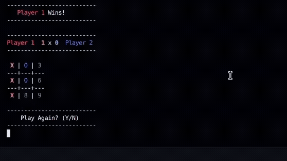

# Tic Tac Toe

A command-line Tic Tac Toe game built with Ruby as part of [The Odin Project](https://www.theodinproject.com/).

## Demo



## Features

- Two-player gameplay in the terminal.
- Interactive 3×3 game board.
- Input validation to prevent invalid moves and selecting occupied cells.
- Automatic turn switching between players.
- Win detection across rows, columns, and diagonals.
- Score tracking across multiple rounds.
- Colored player symbols and scores using the `colorize` gem.
- Highlighting of the winning combination.
- Tie detection.
- Option to play multiple rounds without restarting the program.

## Built With

- Ruby
- [Colorize](https://github.com/fazibear/colorize) — for colored terminal output.

## Getting Started

### Prerequisites

Make sure Ruby is installed on your system.

Install the `colorize` gem:

```bash
gem install colorize
```

### Running the Game

1. Clone the repository:

   ```bash
   git clone https://github.com/thiagoono/odin-tic-tac-toe.git
   ```

2. Navigate to the project directory:

   ```bash
   cd odin-tic-tac-toe
   ```

3. Run the game:

   ```bash
   ruby lib/tic_tac_toe.rb
   ```

## How to Play

1. The game starts with an empty 3×3 board.
2. Players take turns entering a number from `1` to `9`, corresponding to a position on the board.
3. Invalid moves and attempts to select occupied positions are rejected.
4. The first player to align three symbols horizontally, vertically, or diagonally wins the round.
5. If all nine positions are filled without a winner, the round ends in a tie.
6. After each round, players can choose whether to play again.

## Project Structure

```text
odin-tic-tac-toe/
├── assets/
│   └── demo.gif
├── lib/
│   ├── tic_tac_toe.rb
│   └── tic_tac_toe/
│       ├── board.rb
│       ├── player.rb
│       └── interface.rb
└── README.md
```

- `tic_tac_toe.rb` — coordinates the game flow.
- `board.rb` — manages the board state, player turns, win detection, and scores.
- `player.rb` — stores player information and handles move input.
- `interface.rb` — displays the board, scores, and game messages.

## License

This project was created for educational purposes as part of The Odin Project curriculum.